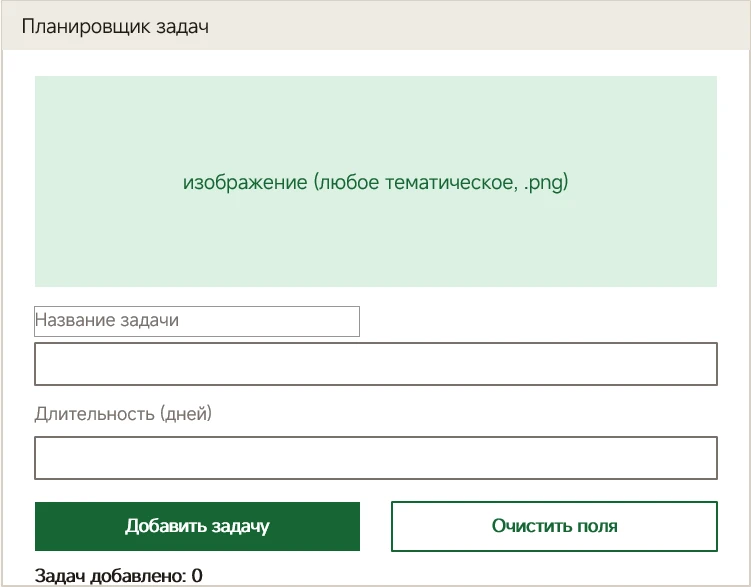

Создатель: Гринчук Виктория Ивановна

Тема: Приложение «Планировщик задач»

ТЗ:
Требуется в приложении:
1. Окно: заголовок «Планировщик задач», размер примерно 460×520, иконка.
2. Изображение вверху окна через PhotoImage + Label с параметром image
3. Два поля Entry с подписями-Label: название задачи и длительность в днях.
4. Две кнопки: «Добавить задачу» увеличивает счётчик в нижней метке и показывает введённую задачу; «Очистить поля» стирает оба Entry.

Образец внешнего вида приложения: 

Чек-лист:
1. Окно создано через Tk(), есть заголовок и размер.
2. Изображение выводится через PhotoImage и Label.
3. Два поля Entry с подписями-Label над ними.
4. Кнопка «Добавить задачу» срабатывает через command.
5. При нажатии счётчик «Задач добавлено: N» обновляется, а текст из полей попадает в нижнюю метку (метод get()).
6. Кнопка «Очистить поля» очищает оба Entry (delete(0, END)).
7. Код прокомментирован: у каждого виджета пояснение.